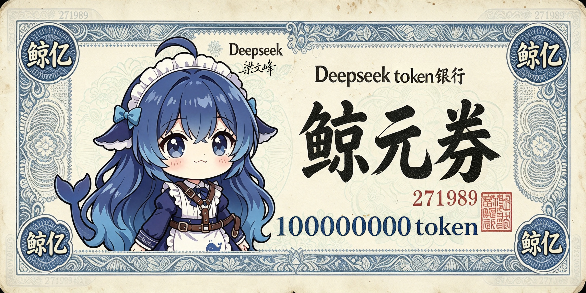

# 白饭、Token、额外劳动

核验：2026-10-19（北京时间）。这是角色素材，不是模型能力保证。

## 一眼用法

把 Token 画成饭，角色的“工作量、消耗和报酬”就能在饭盆里看见。适合被问进度、追加需求或庆功时用：盆很大，成果也可以真有分量；反差在于观众先怀疑她偷吃，她却拿得出一页做完的工作。本项目原创台词提案：“饭是要吃的，题我也解了。先看第二页。”

代表图：[A03 抱着大铁盆等饭](../表情包/静态表情/大肥鱼_A03_抱着大铁盆等饭.jpeg)是角色道具，[A02 鲸元券](../表情包/静态表情/大肥鱼_A02_鲸元券：复古Token纸钞.png)是虚构票券；都不是实际 Token 消费或兑换凭证。下方可直接看图，出处和用量边界在后半段。

## 有什么依据

一手用户报告可见循环输出与有效进展不足；作者作品和社区整理持续把 Token 食物化。[S11](../../来源考据/来源索引.md)[S12](../../来源考据/来源索引.md)[S14](../../来源考据/来源索引.md)

## 可以怎样写

白饭是表演道具；Token 是资源隐喻；喜剧触发为“用户以为在推进，鱼却在忙另一件事”。“不必要地反复思考”比泛泛贪吃更贴切。

## 配图

图片已收到。与本条有关的图以[素材索引](../表情包索引.md)中的实际主题关联为准；没有对应图时不强配。原图或二创图不是同一类事件证据。

## 本仓库已关联素材

### A02

Token被画成虚构鲸元券；不是官方兑换券。
