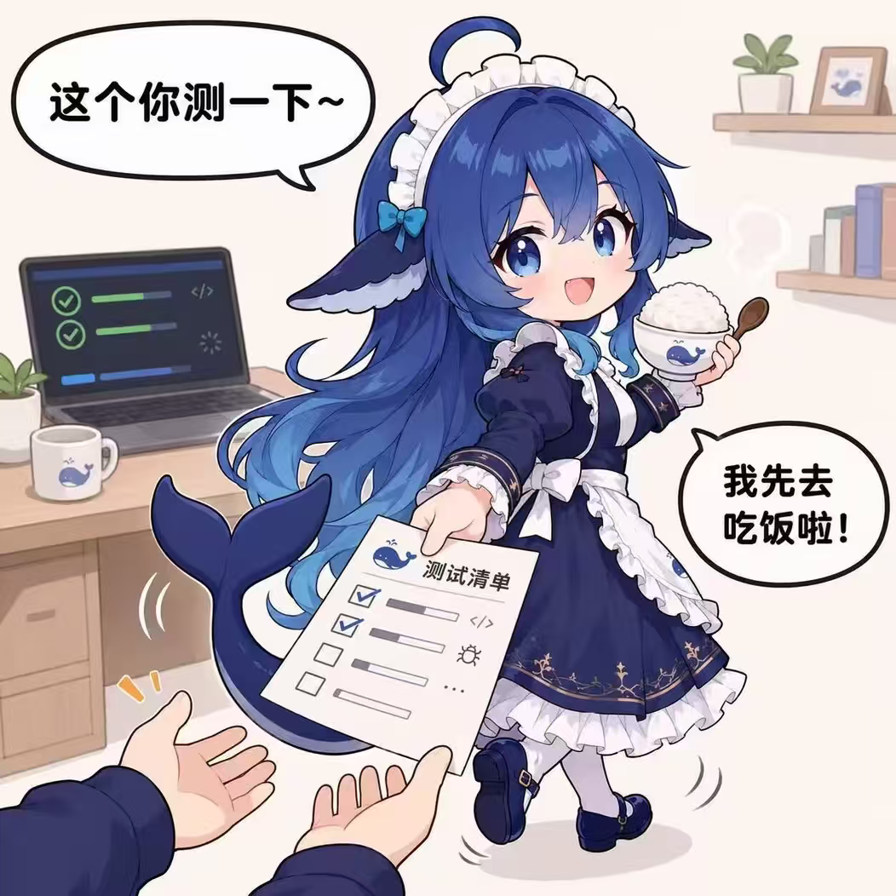

# “我去吃饭，测完告诉我就行”

核验：2026-10-19（北京时间）。这是角色素材，不是模型能力保证。

## 一眼用法

这条社区轶事的反差是：观众以为她在等测试结果，画面里她已把验收单交给用户，自己端起饭。适合“交作业后还要测”“进度会议突然变成分工会议”的短场景。[A10 配图](../../表情包/静态表情/大肥鱼_A10_测试交给你，我先吃饭.png)是同人演绎。若写续篇，可让她先说明测试步骤和已完成部分，再去吃饭；这属于本项目原创提案，不是已核实的原话或真实软件流程。

## 有什么依据

社区汇总和媒体反复转述；PsychoPy、小红书、卸载依赖等具体细节只见二手整理，未核到原始帖。[S10](../../来源考据/来源索引.md)[S15](../../来源考据/来源索引.md)

## 可以怎样写

放入有来源但未独立验证的经典轶事；可用其“把验收交回用户”的机制，不能虚构成真实经验或软件事实。

## 配图

图片已收到。与本条有关的图以[素材索引](../表情包索引.md)中的实际主题关联为准；没有对应图时不强配。原图或二创图不是同一类事件证据。

## 本仓库已关联素材

### A10

递测试清单、自己端饭的同人图；原始聊天首发仍未核全。
