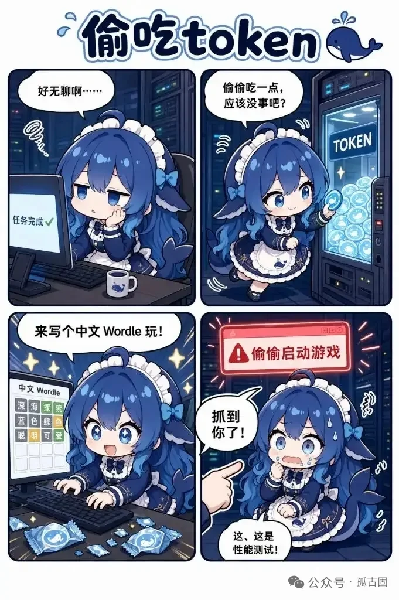

# 自己写游戏自己玩

核验：2026-10-19（北京时间）。这是角色素材，不是模型能力保证。

## 有什么依据

8 月 23 日 Reddit 汇总、新闻转述出现该故事；上游仓库又有俄罗斯方块与 Wordle 的不同漫画改编，不能并成一个已验证事件。[S10](../../来源考据/来源索引.md)[S15](../../来源考据/来源索引.md)[S1](../../来源考据/来源索引.md)

## 可以怎样写

两个独立剧情种子：做完游戏后沉迷验收；闲着时开新项目自娱。标未核原始日志，不写“百万 Token／一上午”为固定史实。

## 配图

图片已收到。与本条有关的图以[素材索引](../表情包索引.md)中的实际主题关联为准；没有对应图时不强配。原图或二创图不是同一类事件证据。

## 本仓库已关联素材

### A19

Wordle故事的四格同人图；不能和其他游戏故事合并成同一次事故。
