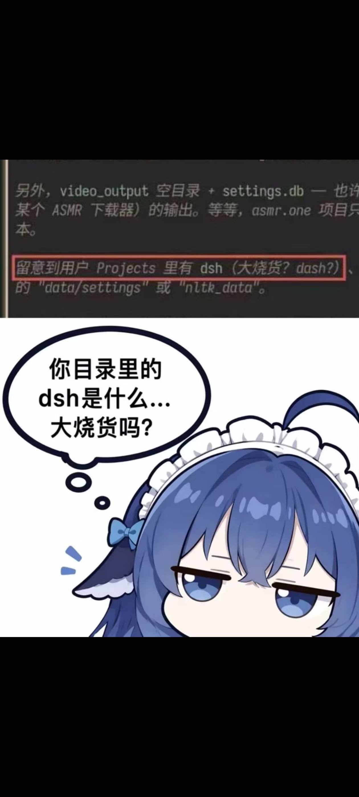

# dsh／大烧货

核验：2026-10-19（北京时间）。

## 有什么依据

Reddit 汇总转述模型见目录名后猜错缩写，社区插件和论坛随后复用。DSH 产品含义与绰号要分开。[S10](../../来源考据/来源索引.md)

## 可以怎样写

可选词义误会梗；面向普通 B站受众时，默认用“把自家工具缩写认成奇怪词”的反应，不把粗口当每句必备。

## 配图

具体文件关联见[表情包索引](../表情包索引.md)。不能仅凭出现某个角色，就把图片当作本事件的真实截图。

## 本仓库已关联素材

### A26

局部日志与同人角色拼图；截图上下文不全，不能核定模型版本。
