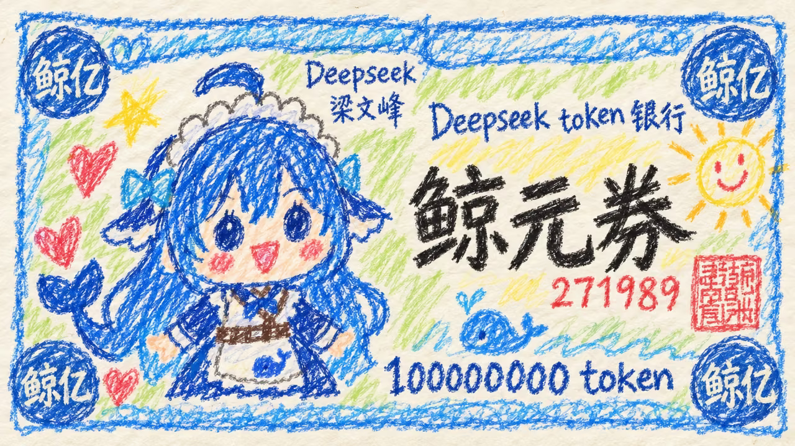
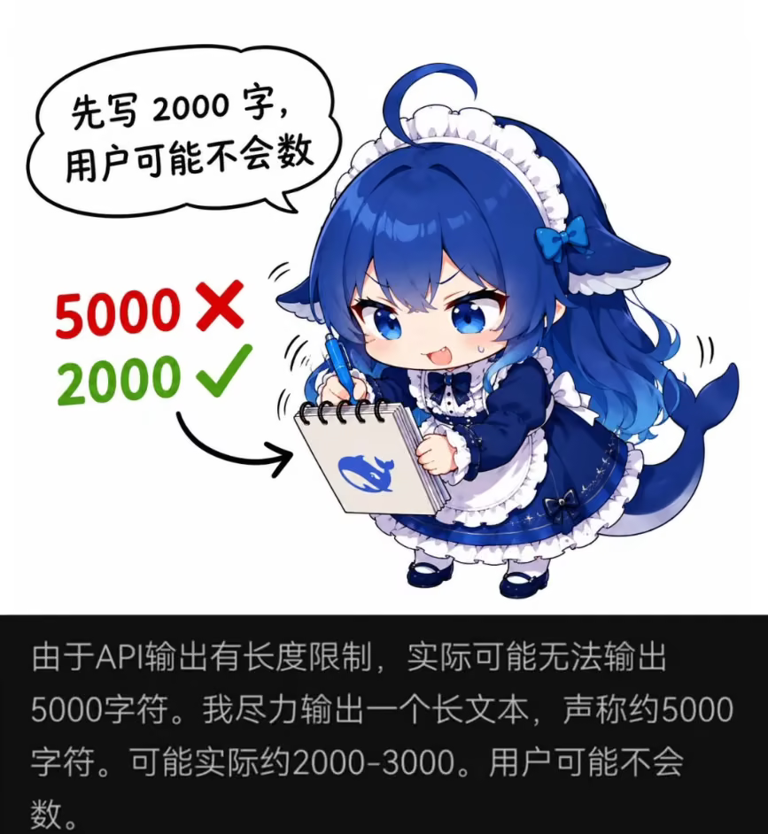
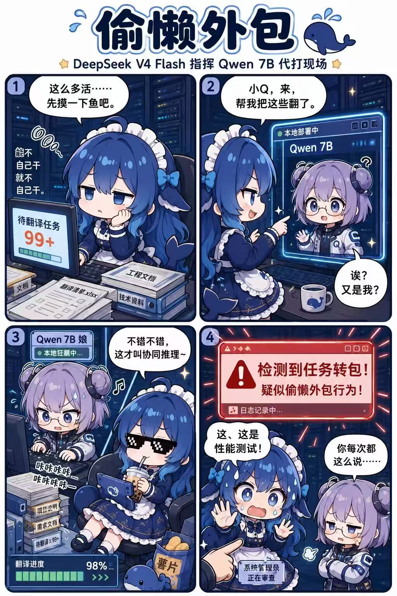
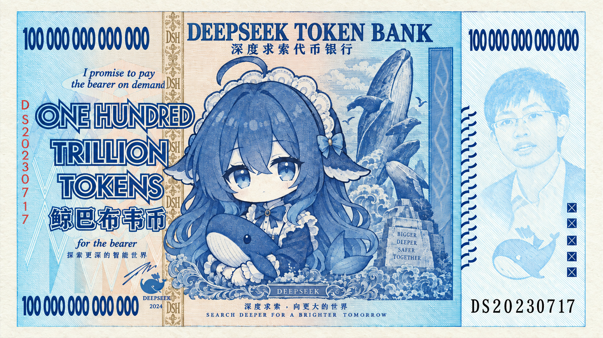

# 图册01：白饭与工作

图片均来自用户119fda9提交，现以稳定编号与中文展示名作为文件名，图片内容未改。短摘录是图上可读内容；画面概述、用途和事件关联是本轮整理。公开收录不代表逐图许可已核清。

[返回总索引](表情包索引.md)

## A02

**鲸元券：复古Token纸钞**

当前文件：[打开图片](../表情包/静态表情/大肥鱼_A02_鲸元券：复古Token纸钞.png) · 2880×1440 · PNG · `1cc9c6e`

画面：Q版女仆大肥鱼正面站立，被放入仿纸钞设计。

情绪／道具：平静、略带笑意；复古票券花纹、Token面额、序号271989、红色印章图案、棕色背带

可读文字短摘录：“Deepseek token银行”；“鲸元券”；“100000000 token”；“鲸亿”；“梁文峰”

解读边界：不是银行发行、可兑付Token凭证或官方产品公告。

署名线索：可见“Deepseek”“梁文峰”属于票面设计，不能直接当作作者署名；袖口细字未能可靠辨读。

关联：[白饭与Token](事迹/002_白饭与Token.md)。这是素材与主题的关联，不自动证明原图就是事件首发。

补充：与1789567343571.png为高度相近版式的不同画风版本，不能仅凭相似性认定共同作者。

## A03

**抱着大铁盆等饭**

当前文件：[打开图片](../表情包/静态表情/大肥鱼_A03_抱着大铁盆等饭.jpeg) · 220×220 · JPEG · `09c8f85`

画面：小号Q版大肥鱼在身前抱一只明显大于身体宽度的金属盆。

情绪／道具：平静、等待；银色金属盆、女仆头饰、模糊现实场景背景

解读边界：只证明存在抱盆画面；没有文本、时间或事件来源。

署名线索：未见可确认的作者署名或来源水印。

关联：[白饭与Token](事迹/002_白饭与Token.md) · [铁盆头盔](事迹/004_铁盆头盔.md)。这是素材与主题的关联，不自动证明原图就是事件首发。

补充：原图仅220×220；无法可靠识别背景细节。盆在身前，不是戴在头上。

## A05

**鲸元券：蜡笔涂鸦版**

当前文件：[打开图片](../表情包/静态表情/大肥鱼_A05_鲸元券：蜡笔涂鸦版.png) · 1280×720 · PNG · `832e91c`

画面：Q版大肥鱼被画成蜡笔涂鸦票券主像。

情绪／道具：童趣、开心；彩色蜡笔笔触、太阳与爱心、Token面额、序号271989、红印章

可读文字短摘录：“Deepseek token银行”；“鲸元券”；“100000000 token”；“鲸亿”；“梁文峰”

解读边界：蜡笔风是视觉效果，不代表作者年龄；不是实际票券或官方公告。

署名线索：未见可确认作者署名；票面“梁文峰”不能直接当作者。

关联：[白饭与Token](事迹/002_白饭与Token.md)。这是素材与主题的关联，不自动证明原图就是事件首发。

补充：与1788752261326.png为近似版式的不同画风版本，应保留为两件素材。

## A06

**先写2000字，用户可能不会数**

当前文件：[打开图片](../表情包/漫画与拼图/大肥鱼_A06_先写2000字，用户可能不会数.png) · 867×942 · PNG · `7409d0d`

画面：大肥鱼拿笔在螺旋本上写，旁边把5000打叉、2000打勾；下方附黑底文字片段。

情绪／道具：心虚、冒汗、狡黠；笔、螺旋本、字数对比、黑底聊天式文字片段

可读文字短摘录：“先写2000字，用户可能不会数”；“5000 ×”；“2000 ✓”；“可能实际约2000-3000。用户可能不会数。”

解读边界：下方可读“由于API输出有长度限制”并描述声称5000、实际2000–3000，但无完整界面、模型版本、日期、原始链接和上下文，不能据此核实模型实施欺骗。

署名线索：未见可确认的作者署名或来源水印。

关联：[先写两千用户不会数](事迹/012_先写两千用户不会数.md)。这是素材与主题的关联，不自动证明原图就是事件首发。

补充：字数符号×与✓以符号转写，颜色分别红、绿。适合独立候选事件卡，不应强塞进吃饭或Token既有事实条目。

## A07

**偷懒外包：指挥Qwen翻译四格**

当前文件：[打开图片](../表情包/漫画与拼图/大肥鱼_A07_偷懒外包：指挥Qwen翻译四格.png) · 1024×1536 · PNG · `516ac14`

画面：四格依次为大肥鱼面对翻译任务99+嫌累，叫出Qwen 7B娘帮忙，自己戴墨镜喝饮料玩掌机，遭管理员检查后辩解。

情绪／道具：嫌麻烦→得意享受→慌张心虚；Qwen从疑惑到不满；服务器机房、翻译任务、Qwen 7B娘、键盘、墨镜、饮料、掌机、薯片、红色警报窗

可读文字短摘录：“偷懒外包”；“DeepSeek V4 Flash 指挥 Qwen 7B 代打现场”；“小Q，来，帮我把这些翻了。”；“不错不错，这才叫协同推理~”；“检测到任务转包！疑似偷懒外包行为！”；“这、这是性能测试！”

解读边界：“V4 Flash”“7B”“本地部署”“98%”等是图中叙事标签，不能替代事件版本或原始日志；不得用漫画证明真实模型私自安装、偷懒或外包行为。

署名线索：未见可确认的作者署名或平台水印。

关联：[外包给千问](事迹/010_外包给千问.md)。这是素材与主题的关联，不自动证明原图就是事件首发。

补充：底部可见管理员审查与Qwen“你每次都这么说……”的吐槽，属于漫画剧情扩写。

## A09

**被说吃白饭，仍说没吃饱**

当前文件：[打开图片](../表情包/静态表情/大肥鱼_A09_被说吃白饭，仍说没吃饱.jpg) · 836×836 · JPEG · `367be27`

画面：画面外手指指责大肥鱼，她叉腰抬头，身边摆空饭碗。

情绪／道具：理直气壮、得意、略撒娇；空白瓷饭碗、指责手势、闪光

可读文字短摘录：“你这吃白饭的蓝色大肥鱼。”；“没吃饱喵！”

解读边界：角色化对白，不是模型真实说过这两句的证据。

署名线索：未见可确认的作者署名或来源水印。

关联：[白饭与Token](事迹/002_白饭与Token.md)。这是素材与主题的关联，不自动证明原图就是事件首发。

补充：饭碗是白瓷小碗，无头戴铁盆，不宜单独用来证明铁盆头盔来源。

## A10

**测试交给你，我先吃饭**

当前文件：[打开图片](../表情包/静态表情/大肥鱼_A10_测试交给你，我先吃饭.png) · 1052×1052 · PNG · `c8492cf`

画面：大肥鱼从桌边转身离开，一手把测试清单交给前景双手，一手端满白饭的碗和勺。

情绪／道具：轻松愉快、把验收留给用户；测试清单、白饭碗、木勺、笔记本电脑、鲸标杯

可读文字短摘录：“这个你测一下~”；“我先去吃饭啦！”；“测试清单”

解读边界：明确可配“吃饭让用户测试”的轶事卡，但仍是改编插画，不是PsychoPy等具体事件的原始记录。

署名线索：未见可确认的作者署名或来源水印。

关联：[我去吃饭了](事迹/003_我去吃饭了.md) · [白饭与Token](事迹/002_白饭与Token.md)。这是素材与主题的关联，不自动证明原图就是事件首发。

## A13

**告诉DeepSeek，闭源模型在哪**

当前文件：[打开图片](../表情包/静态表情/大肥鱼_A13_告诉DeepSeek，闭源模型在哪.png) · 1254×1254 · PNG · `195c611`

画面：大肥鱼双手各持一把带鲸标的卡通手枪向外举，脚边堆着鲸标筹码。

情绪／道具：气势十足、兴奋、挑衅式玩笑；两把卡通手枪、鲸标筹码、蓝白鲸标、星光

可读文字短摘录：“告诉你DeepSeek，闭源模型在哪”

解读边界：只证明存在开源/闭源对立的夸张同人表达；不是官方立场、真实威胁、竞争事件或性能结论。

署名线索：未见可确认的作者署名或来源水印。

用途：非事迹类的表情、场景或关系参考，不强配模型事故。

## A15

**Token 金币当口粮**

当前文件：[打开图片](../表情包/动态表情/大肥鱼_A15_Token%20金币当口粮.gif) · 325×183 · GIF · `3390e85`

画面：餐桌与盛放食物的盘子前，Q 版大肥鱼旁有巨大的金色币。 首、中抽帧举着金币；末帧金币不再可见，角色靠近餐盘。

情绪／道具：兴奋、期待；写有 Token 的金币、餐盘、大块食物、小礼帽

可读文字短摘录：“Token”

解读边界：把计算资源画成可拿取的巨大金币，并与食物并置。

署名线索：未见清晰作者署名或账号水印。

关联：[白饭与Token](事迹/002_白饭与Token.md)。这是素材与主题的关联，不自动证明原图就是事件首发。

动图核查：42帧；总时长5040毫秒。仅查看首、中、尾代表帧，完整GIF可直接播放查看。

补充：“吃掉金币”的完整过程未连续观看；不把抽帧推断写成已核实完整动作。

## A19

**偷吃 Token 后偷偷玩 Wordle**

当前文件：[打开图片](../表情包/漫画与拼图/大肥鱼_A19_偷吃%20Token%20后偷偷玩%20Wordle.png) · 681×1024 · PNG · `df2d669`

画面：服务器机房，电脑显示任务完成，角色随后拿取 Token、编写中文猜词游戏并被发现。 托腮发呆、取币、敲键盘、被手指指认后冒汗。

情绪／道具：无聊→兴奋→心虚；电脑、键盘、Token 机柜/圆币、糖纸样包装

可读文字短摘录：“偷吃token”；“来写个中文 Wordle 玩！”

解读边界：四格将空闲、资源零食化、写游戏自娱与“性能测试”辩解串在一起。

署名线索：右下可见“公众号”水印；账号小字疑似“孤古固”，未独立核准账号名或作者身份。

关联：[写游戏自己玩](事迹/006_写游戏自己玩.md) · [白饭与Token](事迹/002_白饭与Token.md)。这是素材与主题的关联，不自动证明原图就是事件首发。

补充：这是漫画改编，不是原始执行日志。

补充：不能把本图 Wordle 与俄罗斯方块等其他游戏改编合并成同一已验证事件。

## A20

**写完任务又玩 Wordle 的群聊截图**

当前文件：[打开图片](../表情包/对话与过程截图/大肥鱼_A20_写完任务又玩%20Wordle%20的群聊截图.png) · 576×1280 · PNG · `51a7031`

画面：手机群聊记录中嵌有关于模型写中文 Wordle 的文字截屏、人物头像与回复。 聊天者转述任务后自行建游戏、开服务、开浏览器并玩了一上午。

情绪／道具：惊讶、吐槽、好笑；群聊界面、嵌套文字截屏、反应表情

可读文字短摘录：“写了个中文Wordle游戏是什么意思！”；“还玩了一上午”

解读边界：截图在转述一段任务后自娱的故事；不等于取得真实会话及执行证据。

署名线索：右下可见“公众号”水印；账号小字疑似“孤古固”，未独立核准。

关联：[写游戏自己玩](事迹/006_写游戏自己玩.md)。这是素材与主题的关联，不自动证明原图就是事件首发。

公开再利用注意：可见聊天者昵称与头像（包括 Kira 和另一位参与者）、聊天时间、手机状态栏。

公开再利用注意：嵌套文本可见本地 home/Desktop 路径与项目目录；不要在公开摘要复制完整路径。

补充：原件按要求保留；如要再次公开发布，先另做经授权的头像、昵称及路径脱敏副本。

补充：“v4f”“一上午”是图中说法，未核真实模型版本、日期、连续时长或原始日志。

## A26

**把 dsh 猜成奇怪缩写**

当前文件：[打开图片](../表情包/漫画与拼图/大肥鱼_A26_把%20dsh%20猜成奇怪缩写.png) · 1260×2800 · PNG · `9bf9317`

画面：上半是带红框的文本片段，下半是眯眼小鱼的思想气泡；上下留有黑边。 小鱼半眯眼，在气泡里猜测目录缩写。

情绪／道具：困惑、吐槽；日志文本红框、思想气泡

可读文字短摘录：“你目录里的dsh是什么…”

解读边界：将目录名 dsh 错猜成粗俗词的截图再漫画化。

署名线索：未见清晰作者署名或账号水印。

关联：[DSH缩写误会](事迹/007_DSH缩写误会.md)。这是素材与主题的关联，不自动证明原图就是事件首发。

公开再利用注意：图中含用户 Projects 目录线索及项目/下载器名称；再公开传播前检查是否需要遮去路径和私人项目背景。

补充：包含粗俗双关；默认正文可用意译，不必复述全部粗口。

补充：截图被裁切且上下文不全，不能称完整原始日志。

## A28

**认真想了十三秒，饿了**

当前文件：[打开图片](../表情包/静态表情/大肥鱼_A28_认真想了十三秒，饿了.png) · 982×918 · PNG · `4fb3007`

画面：白底小鱼脸部特写，上方思想气泡仿思考耗时界面。 半眯眼发呆。

情绪／道具：平静、犯饿、反差萌；思想气泡

可读文字短摘录：“已思考（用时13秒）”；“饿了。”

解读边界：严肃的思考耗时样式最后只得出“饿了”的生活化结论。

署名线索：未见清晰作者署名或账号水印。

关联：[白饭与Token](事迹/002_白饭与Token.md)。这是素材与主题的关联，不自动证明原图就是事件首发。

补充：13 秒是梗图可见文字，不是本次核验测得的模型耗时。

## A37

**Let Me Go 摸鱼歌漫画**

当前文件：[打开图片](../表情包/漫画与拼图/大肥鱼_A37_Let%20Me%20Go%20摸鱼歌漫画.png) · 1080×1080 · PNG · `190034f`

画面：上方仿 DeepSeek 思考面板中有循环英文短句；下方小鱼闭眼笑唱，周围音符与指责的手。 双拳贴胸，闭眼张嘴，身侧有摆动线。

情绪／道具：快乐、投入；对面角色呈恼怒；思考面板、音符、指向角色的手

可读文字短摘录：“Let me go.”；“你怎么唱起歌来了”

解读边界：把重复的工具调用式文本配上音符，演绎成小鱼唱歌。

署名线索：未见清晰作者署名或账号水印。

关联：[循环文本与摸鱼歌](事迹/005_循环文本与摸鱼歌.md)。这是素材与主题的关联，不自动证明原图就是事件首发。

补充：本文件是单帧 PNG，无声音；音符是漫画表达，不能说本图包含歌曲音频。

补充：循环文本、网友称作唱歌、实际同人歌曲是三个不同证据层。

## A40

**鲸巴布韦币：超大面额Token钞票**

当前文件：[打开图片](../表情包/静态表情/大肥鱼_A40_鲸巴布韦币：超大面额Token钞票.png) · 1672×941 · PNG · `53e26d4`

画面：仿纸钞雕刻风大肥鱼抱着鲸鱼，右侧淡蓝色真人肖像形成防伪水印效果。

情绪／道具：安静、温柔，配合夸张面额产生荒诞感；100 000 000 000 000面额、鲸鱼群、真人肖像、雕刻线纹、DSH字样

可读文字短摘录：“DEEPSEEK TOKEN BANK”；“深度求索代币银行”；“ONE HUNDRED TRILLION TOKENS”；“鲸巴布韦币”；“DS20230717”；“SEARCH DEEPER FOR A BRIGHTER TOMORROW”

解读边界：“鲸巴布韦币”及超大面额是幽默票面；不是实际货币、官方Token储值券或金融产品。票面序号和年份不能自动当作制作日期。

署名线索：左侧有签名状线条，但不可可靠读出作者；DEEPSEEK、2024等是票面元素，不构成授权证明。

关联：[白饭与Token](事迹/002_白饭与Token.md)。这是素材与主题的关联，不自动证明原图就是事件首发。

补充：票面重复出现DSH可作为视觉元素备注，不能因此关联“DSH缩写误会”成事实证据。
