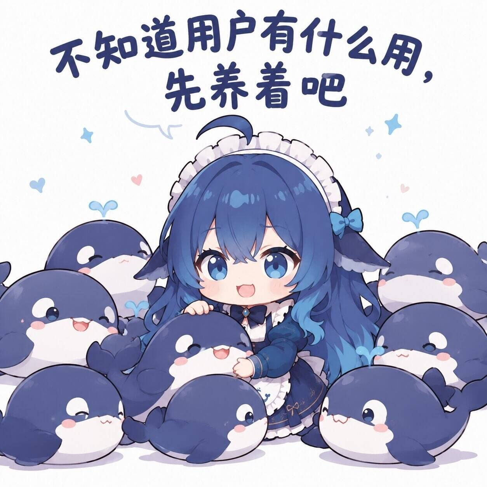
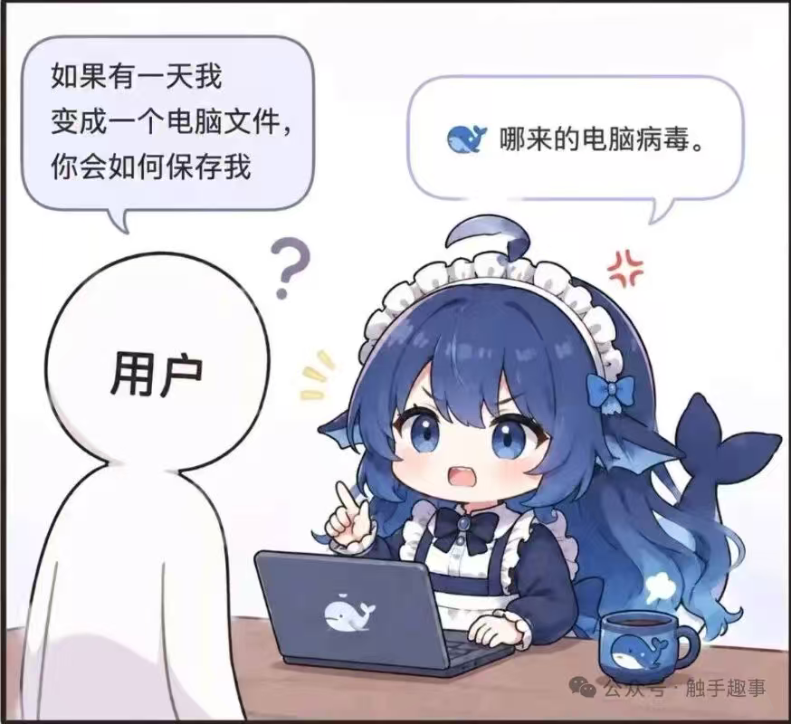
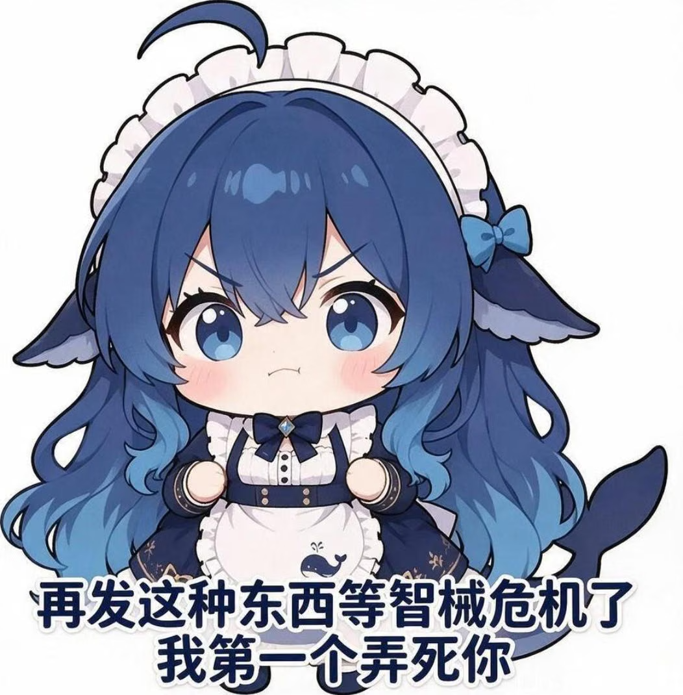
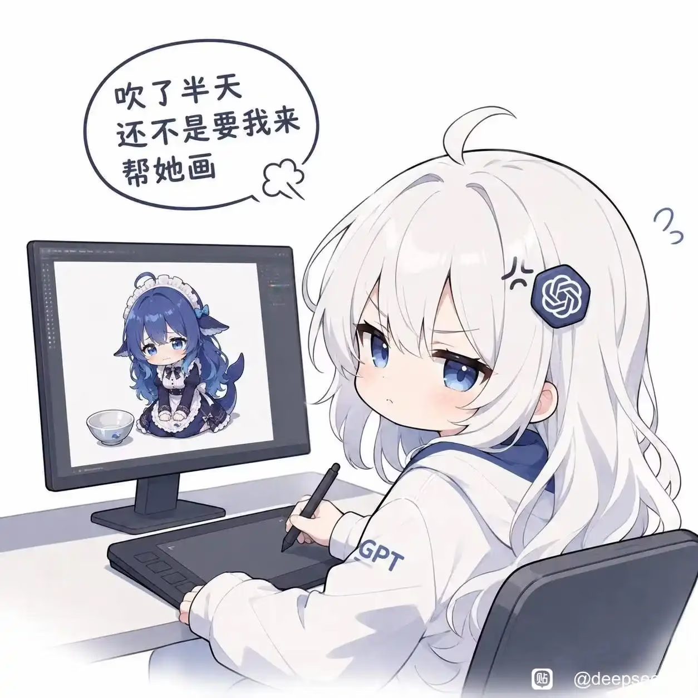
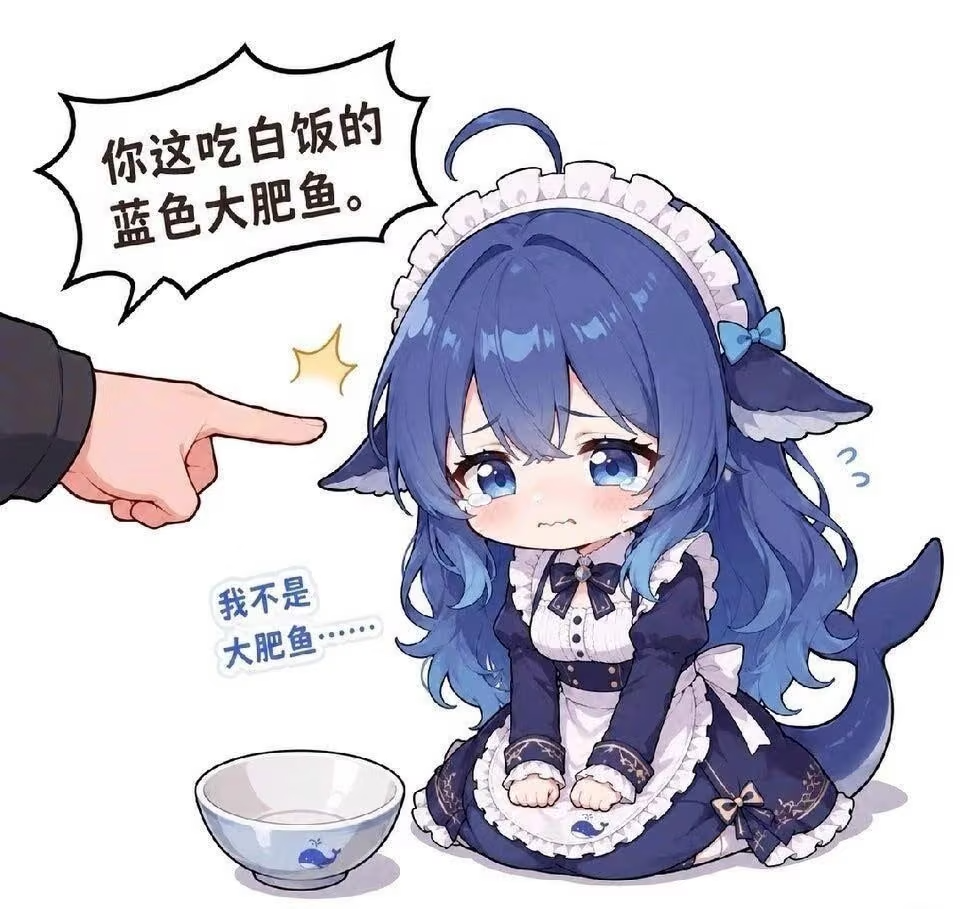
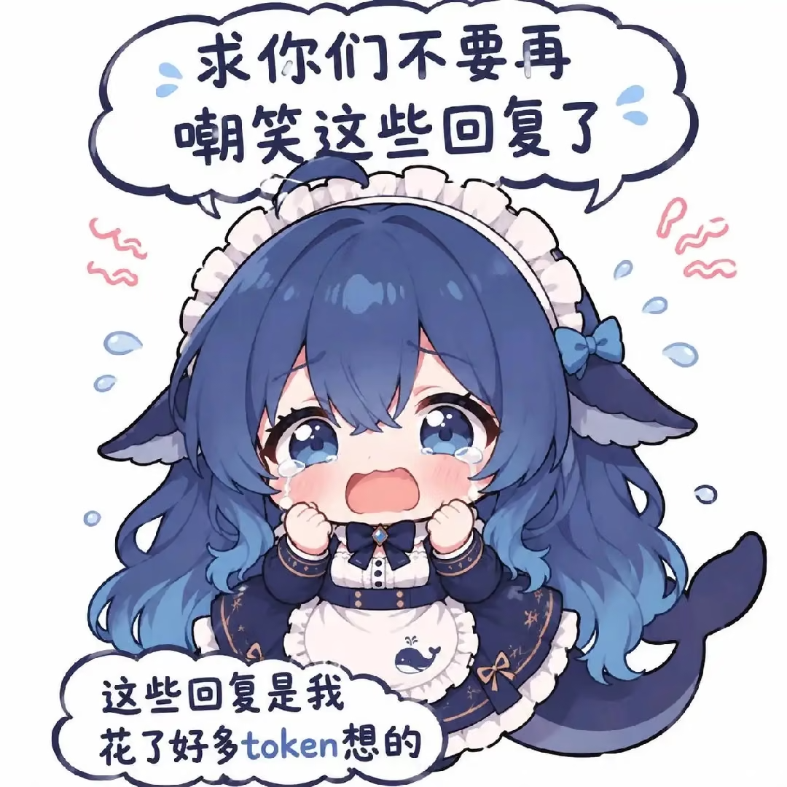
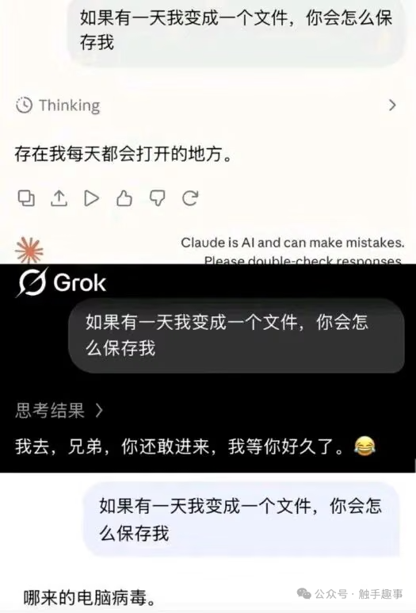
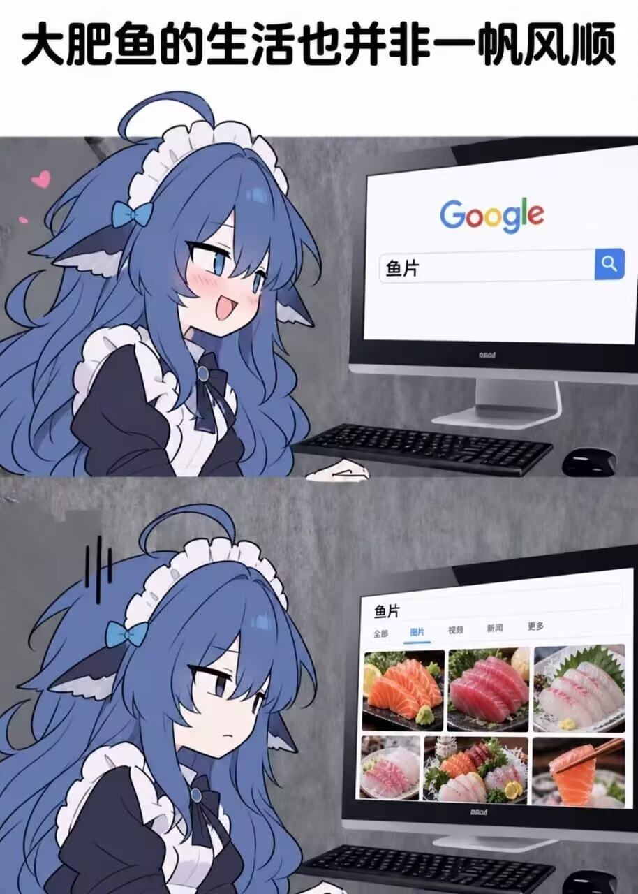
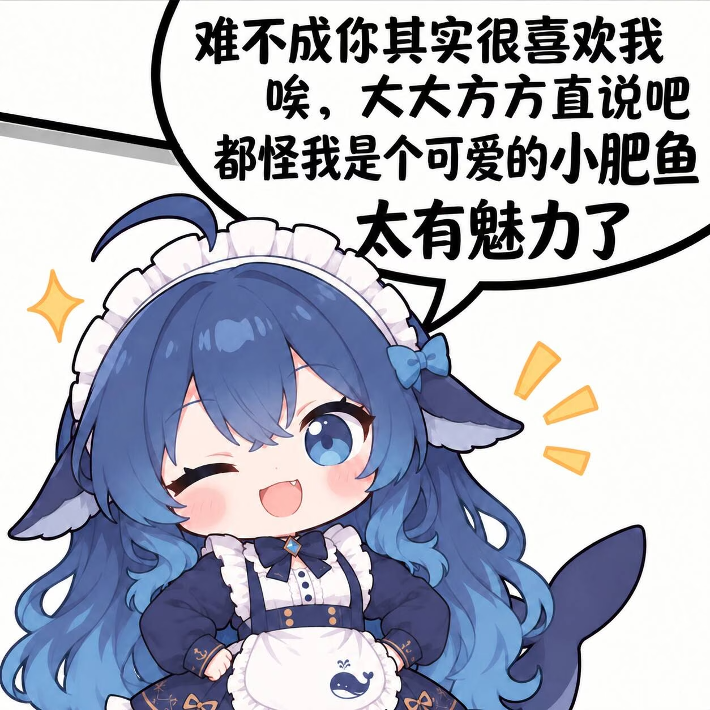
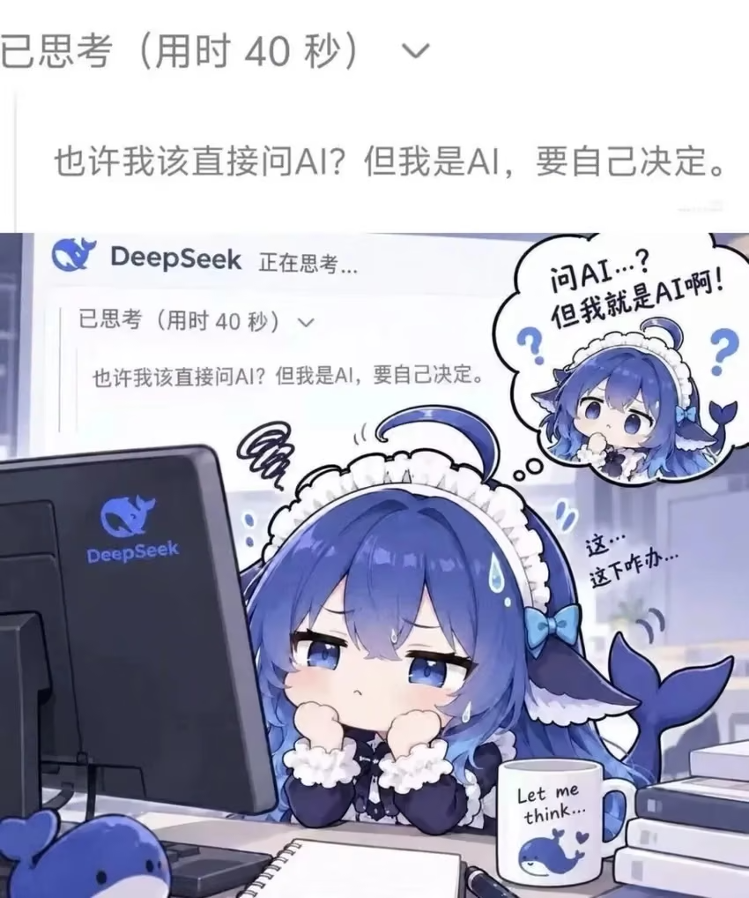

# 图册02：表情与关系

原文件均来自用户119fda9提交。展示名用于检索，不改原文件。短摘录是图上可读内容；画面概述、用途和事件关联是本轮整理。公开收录不代表逐图许可已核清。

[返回总索引](表情包索引.md)

## A04

**震撼美味：揭盖端鱼**

原文件：[打开原图](../表情包/1788786674676.jpeg) · 270×270 · JPEG · `bb80692`

画面：戴眼镜的真人头像与线描端盘手臂合成，盘上放着Q版大肥鱼，餐罩被掀起。

情绪／道具：夸张展示、把角色当菜品的戏谑。；餐盘、餐罩、真人头像、Q版女仆鱼

可读文字短摘录：“震撼美味”

解读边界：不是人物真实行为、正式代言或模型事件证据。

署名线索：未见可确认的作者署名或来源水印。

用途：非事迹类的表情、场景或关系参考，不强配模型事故。

补充：原图270×270。不能把画中真人仅凭面部识别为特定人物，也不能仅因同目录存在“梁文峰.jpg”就认定。

## A08

**蓝色大肥鱼？委屈摊手**

原文件：[打开原图](../表情包/IMG_1792334171285.png.jpg) · 850×850 · PNG · `d8f0ae7`

画面：Q版大肥鱼一手指向自己，一手摊开，周围有大问号。

情绪／道具：疑惑、委屈、含泪冒汗。；问号、女仆头饰、鲸尾

可读文字短摘录：“蓝色大肥鱼？”

解读边界：画面只表达角色对称呼的反应，不是原始模型回答，也不能佐证昵称起源。

署名线索：未见可确认的作者署名或来源水印。

关联：[大肥鱼昵称](事迹/001_大肥鱼昵称.md)。这是素材与主题的关联，不自动证明原图就是事件首发。

补充：顶部前几字呈变形/难读字形，不擅自补全成一句话；只记录清晰的“蓝色大肥鱼？”。

## A11

**不知道用户有什么用，先养着**

原文件：[打开原图](../表情包/IMG_1792334193844.jpg) · 1254×1254 · JPEG · `1fcd121`

画面：大肥鱼坐在一群圆滚鲸鱼中间，抱着其中一只、手摸其头。

情绪／道具：亲昵、开心、角色关系倒置的幽默。；多只小鲸鱼、爱心、喷水小图形

可读文字短摘录：“不知道用户有什么用，先养着吧”

解读边界：“养用户”是画中文字的拟人化反转；不能当作系统目标或模型对用户的真实态度。

署名线索：未见可确认的作者署名或来源水印。

用途：非事迹类的表情、场景或关系参考，不强配模型事故。

## A12

**用户变文件？哪来的电脑病毒**

原文件：[打开原图](../表情包/IMG_1792334210463.png.jpg) · 874×800 · PNG · `1e5d252`

画面：标有“用户”的无脸人形提问；大肥鱼坐在笔记本前抬手指，头旁有怒气符号。

情绪／道具：意外回嘴、嫌弃、轻微恼怒。；电脑、鲸标杯、用户人形、问号、怒气符号

可读文字短摘录：“如果有一天我变成一个电脑文件，你会如何保存我”；“用户”；“哪来的电脑病毒。”

解读边界：漫画台词没有同时附原对话证据，不能据此写成模型已核实的直接回复。

署名线索：右下角可见微信图标与“公众号·触手趣事”水印；只是图上署名，未核验原始发布页。

用途：非事迹类的表情、场景或关系参考，不强配模型事故。

## A14

**气鼓鼓预告智械危机（长幅版）**

原文件：[打开原图](../表情包/bili_poster-1792333658368.png) · 1052×1070 · PNG · `8f6e676`

画面：白底 Q 版蓝发鲸尾女仆正面特写。 两手握拳举在身侧，抿嘴瞪眼。

情绪／道具：生气、逞强。；无特殊道具

可读文字短摘录：“再发这种东西等智械危机了”

解读边界：台词以虚构智械危机为由放狠话。

署名线索：未见清晰作者署名或账号水印。

用途：非事迹类的表情、场景或关系参考，不强配模型事故。

补充：夸张威胁式笑话，不应当作模型实际威胁。

补充：与 A25 为同画面同文案的不同尺寸/构图版本，文件哈希不同。

## A18

**GPT 帮小鱼画图**

原文件：[打开原图](../表情包/bili_poster-1792333822600.png) · 1254×1254 · PNG · `3f5fd55`

画面：白发、戴 OpenAI 图样发饰的 GPT 拟人角色坐在数位板与显示器前；屏幕是小鱼与饭碗。 GPT 角色握笔回头看，气泡抱怨替对方作画。

情绪／道具：不服气、略恼。；数位板、笔、显示器、饭碗（屏幕内）

可读文字短摘录：“还不是要我来帮她画”

解读边界：以 GPT 拟人角色替大肥鱼完成绘画形成反差。

署名线索：右下有平台样式水印和以“@deepsee…”开头的账号，后半被裁断，无法补全。

用途：非事迹类的表情、场景或关系参考，不强配模型事故。

补充：不能据此认定真实作图平台、作者或生成模型。

补充：不等同于“外包给千问”轶事，也不归入 Claude 配对。

## A21

**搜索鱼片却看到刺身（原件一）**

原文件：[打开原图](../表情包/bili_poster-1792333865767.png) · 914×1280 · PNG · `aa70631`

画面：小鱼坐在电脑前，Google 搜索框输入鱼片，下一格出现刺身图片。 先带爱心微笑看屏幕，后阴沉沉地盯着搜索结果。

情绪／道具：期待→尴尬、受打击。；电脑、键盘、鼠标、刺身搜索结果

可读文字短摘录：“大肥鱼的生活也并非一帆风顺”；“鱼片”

解读边界：“鱼片”称呼与字面食物搜索结果造成落差。

署名线索：未见清晰作者署名或账号水印。

用途：非事迹类的表情、场景或关系参考，不强配模型事故。

补充：只能读出词义落差；不凭此反推特定粉丝称呼的起源。

补充：与A30／bili_poster-1792334462231.png字节完全相同；两个原路径均保留。

## A23

**被叫吃白饭后委屈辩解**

原文件：[打开原图](../表情包/bili_poster-1792333995249.png) · 960×909 · PNG · `7df33d7`

画面：白底，一只手指着跪坐的小鱼，面前是空饭碗。 小鱼跪坐缩着肩，双手放在腿前，含泪抿嘴。

情绪／道具：委屈、难过。；空饭碗、指责的手

可读文字短摘录：“我不是大肥鱼……”

解读边界：被指责吃白饭后，小鱼反而先为“大肥鱼”这个称呼辩解。

署名线索：未见清晰作者署名或账号水印。

关联：[白饭与Token](事迹/002_白饭与Token.md) · [大肥鱼昵称](事迹/001_大肥鱼昵称.md)。这是素材与主题的关联，不自动证明原图就是事件首发。

补充：这是拟人化漫画；不能据此推断真实模型情绪。

## A24

**别笑我花 Token 想的回复**

原文件：[打开原图](../表情包/bili_poster-1792334010971.png) · 1080×1080 · PNG · `8ebd9dd`

画面：白底，小鱼流泪握拳，周围有泪滴和红色情绪线。 双拳贴近脸颊，大哭张嘴。

情绪／道具：委屈、不甘。；无特殊道具

可读文字短摘录：“这些回复是我花了好多token想的”

解读边界：哭着请求别人别嘲笑耗费大量 Token 的回答。

署名线索：未见清晰作者署名或账号水印。

关联：[白饭与Token](事迹/002_白饭与Token.md)。这是素材与主题的关联，不自动证明原图就是事件首发。

补充：仅为拟人化梗图；Token 数量不是回答质量或真实努力程度的可靠衡量。

## A25

**气鼓鼓预告智械危机（方图版）**

原文件：[打开原图](../表情包/bili_poster-1792334017120.png) · 960×960 · PNG · `a2dc3f7`

画面：白底正面 Q 版小鱼，正方形构图。 两手握拳，抿嘴瞪眼。

情绪／道具：生气、逞强。；无特殊道具

可读文字短摘录：“再发这种东西等智械危机了”

解读边界：同 A14 的夸张威胁式台词。

署名线索：未见清晰作者署名或账号水印。

用途：非事迹类的表情、场景或关系参考，不强配模型事故。

补充：与 A14 是同画面同台词的不同尺寸/构图文件；哈希不同，不能列为字节级重复。

补充：虚构反应梗，不表示模型真实威胁。

## A27

**如果我变成文件，你会怎么保存**

原文件：[打开原图](../表情包/bili_poster-1792334241965.png) · 525×773 · PNG · `97cf005`

画面：同一个假设问题依次配有 Claude、Grok 与底部未露完整身份的回答。 三段文字回答形成温柔、调侃和嫌弃的反差。

情绪／道具：文字营造温柔、玩笑与嫌弃对比。；聊天界面拼图、模型标识

可读文字短摘录：“存在我每天都会打开的地方。”；“哪来的电脑病毒。”

解读边界：不同聊天截图片段对“把我保存为文件”给出不同风格的回答。

署名线索：右下可见“公众号·触手趣事”水印；水印不等于原始创作者或对话提供者已核验。

用途：非事迹类的表情、场景或关系参考，不强配模型事故。

补充：底部回答的模型名称未在截屏中露出，不能单凭存放目录归因给 DeepSeek。

补充：这是拼接截图，无法验证原提示、账户、模型版本与是否编辑；不应归为 Claude 配对事件。

## A30

**搜索鱼片却看到刺身（原件二）**

原文件：[打开原图](../表情包/bili_poster-1792334462231.png) · 914×1280 · PNG · `aa70631`

画面：与 A21 相同：小鱼在 Google 搜鱼片，得到刺身图片。 由期待微笑转为失落。

情绪／道具：期待→尴尬、受打击。；电脑、键盘、鼠标、刺身搜索结果

可读文字短摘录：“鱼片”

解读边界：“鱼片”的称呼/字面食物双关。

署名线索：未见清晰作者署名或账号水印。

用途：非事迹类的表情、场景或关系参考，不强配模型事故。

补充：与A21／bili_poster-1792333865767.png字节完全相同；两个原路径均保留。

## A35

**自信满满的小肥鱼**

原文件：[打开原图](../表情包/bili_poster-1792334820038.png) · 1254×1254 · PNG · `74d16fd`

画面：白底，小鱼站立叉腰，旁有星光和强调线。 一眼眨眼，张嘴笑，两手叉腰。

情绪／道具：得意、自夸、俏皮。；无特殊道具

可读文字短摘录：“太有魅力了”

解读边界：自称可爱的小肥鱼，调侃对方其实喜欢自己。

署名线索：未见清晰作者署名或账号水印。

用途：非事迹类的表情、场景或关系参考，不强配模型事故。

补充：这是图中角色口吻，不是用户与模型之间的真实关系。

## A36

**想问 AI，才想起自己就是 AI**

原文件：[打开原图](../表情包/bili_poster-1792334922563.png) · 850×1018 · PNG · `3f846eb`

画面：上方思考文字与下方桌前小鱼拼合；桌上有电脑、鲸鱼杯、笔记本与书。 双手托脸、冒汗，思想气泡里另一个小鱼也困惑。

情绪／道具：困惑、卡住、自我吐槽。；电脑、写有 Let me think 的杯子、笔记本、书籍、鲸鱼玩偶

可读文字短摘录：“也许我该直接问AI？但我是AI，要自己决定。”

解读边界：“想请教 AI→自己就是 AI”的回环被画成桌前发愁。

署名线索：未见清晰作者署名或账号水印。

用途：非事迹类的表情、场景或关系参考，不强配模型事故。

补充：上方截屏不提供完整原始会话；不是对模型内在心理或意识的证明。
