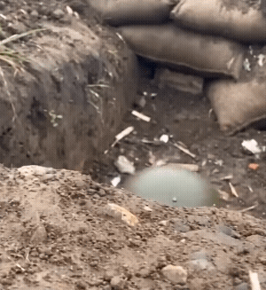
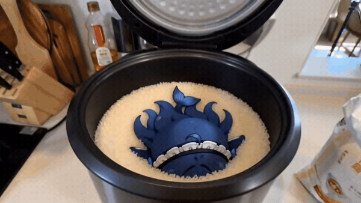
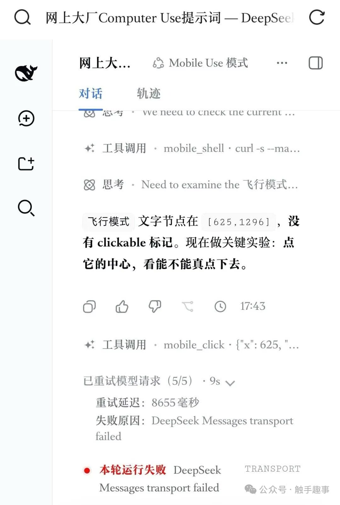

# 图册03：铁盆与动作

图片均来自用户119fda9提交，现以稳定编号与中文展示名作为文件名，图片内容未改。短摘录是图上可读内容；画面概述、用途和事件关联是本轮整理。公开收录不代表逐图许可已核清。

[返回总索引](表情包索引.md)

## A16

**铁盆扣头站岗**

当前文件：[打开图片](表情包/静态表情/大肥鱼_A16_铁盆扣头站岗.png) · 196×231 · PNG · `dec57a0`

画面：泥土地面与土墙前的小尺寸角色立像。 双手垂在身侧，头戴大金属盆站立。

情绪／道具：木然、呆萌；倒扣的大金属盆

解读边界：无可辨文字。

署名线索：未见清晰作者署名或账号水印。

关联：[铁盆头盔](事迹/004_铁盆头盔.md)。这是素材与主题的关联，不自动证明原图就是事件首发。

补充：原图仅 196×231；细部不可放大后臆造。

## A17

**战壕里的头盔小鱼**

当前文件：[打开图片](表情包/动态表情/大肥鱼_A17_战壕里的头盔小鱼.gif) · 300×327 · GIF · `99cd9d1`

画面：土质战壕与沙袋前。 首帧仅见低处头盔；中帧角色戴盔举枪；尾帧角色已不在所见画面内。

情绪／道具：警觉、紧张的恶搞语境；圆顶军用式头盔、步枪形道具、沙袋

解读边界：所见抽帧无可辨文字。

署名线索：未见清晰作者署名或账号水印。

用途：非事迹类的表情、场景或关系参考，不强配模型事故。

动图核查：78帧；总时长9510毫秒。仅查看首、中、尾代表帧，完整GIF可直接播放查看。

补充：这是军用式头盔，不宜直接当成铁盆扣头版本。

补充：含枪械意象；本图不证明任何现实作战事件。

补充：未完整播放，不声称已确认开火、射击声或完整躲避过程。

## A22

**沙发上的气鼓鼓小鱼**

当前文件：[打开图片](表情包/动态表情/大肥鱼_A22_沙发上的气鼓鼓小鱼.gif) · 240×426 · GIF · `8ae556a`

画面：真实感客厅沙发坐垫上放置 Q 版女仆角色。 三帧都举着拳头，手臂位置略变，张嘴皱眉。

情绪／道具：生气、闹小脾气；沙发、抱枕、客厅桌面

解读边界：所见抽帧无可辨文字。

署名线索：未见清晰作者署名或账号水印。

用途：非事迹类的表情、场景或关系参考，不强配模型事故。

动图核查：17帧；总时长1700毫秒。仅查看首、中、尾代表帧，完整GIF可直接播放查看。

补充：不据抽帧声称完整跳跃、跺脚或有声音。

## A29

**端盆仰头等开饭**

当前文件：[打开图片](表情包/动态表情/大肥鱼_A29_端盆仰头等开饭.gif) · 300×300 · GIF · `2b6650f`

画面：暗色室内，角色前方是大金属盆，画面左侧有人形衣料的一部分。 小鱼仰头看上方，手从盆边向上举起，三帧手位有变化。

情绪／道具：期待、可怜巴巴；金属盆

解读边界：所见抽帧无可辨文字。

署名线索：未见清晰作者署名或账号水印。

关联：[白饭与Token](事迹/002_白饭与Token.md)。这是素材与主题的关联，不自动证明原图就是事件首发。

动图核查：12帧；总时长1340毫秒。仅查看首、中、尾代表帧，完整GIF可直接播放查看。

补充：“等开饭”是画面用途的概括；抽帧没有文字证明它的具体请求。

补充：金属盆在手边，不是头盔。

## A31

**钻进电饭锅的饭后小鱼**

当前文件：[打开图片](表情包/动态表情/大肥鱼_A31_钻进电饭锅的饭后小鱼.gif) · 600×338 · GIF · `b3c69c9`

画面：厨房电饭锅内胆中，首帧白米很多，随后抽帧仅留少许米粒，小鱼躺在里面。 首帧头朝下扎在米中；中帧仰躺睁眼；尾帧仰躺闭眼。

情绪／道具：满足、困倦的拟人化读法；电饭锅、米粒

解读边界：所见抽帧呈现“满锅米→空锅里的小鱼”的视觉落差。

署名线索：未见清晰作者署名或账号水印。

关联：[白饭与Token](事迹/002_白饭与Token.md)。这是素材与主题的关联，不自动证明原图就是事件首发。

动图核查：88帧；总时长7330毫秒。仅查看首、中、尾代表帧，完整GIF可直接播放查看。

补充：未连续观看吞吃过程，不能把“吃光全部米”的中间动作写成已目视确认。

补充：不要把拟人角色放锅内的场景当成真实生物行为。

## A32

**小鱼举勺端锅**

当前文件：[打开图片](表情包/动态表情/大肥鱼_A32_小鱼举勺端锅.gif) · 320×320 · GIF · `300f053`

画面：夜色户外餐桌或木质台面上，小鱼面对镜头。 首帧高举勺，锅在前景；中帧锅逼近镜头并挡住身体；尾帧角色站着拿锅。

情绪／道具：兴奋、用力、玩闹；长柄木勺、黑色锅具/平底锅

解读边界：所见抽帧无可辨文字。

署名线索：未见清晰作者署名或账号水印。

用途：非事迹类的表情、场景或关系参考，不强配模型事故。

动图核查：71帧；总时长8880毫秒。仅查看首、中、尾代表帧，完整GIF可直接播放查看。

补充：这是锅和勺，不能仅因金属道具就标为“铁盆扣头”。

补充：未完整播放，不推断击打对象或音效。

## A33

**挥动毛掸的小鱼**

当前文件：[打开图片](表情包/动态表情/大肥鱼_A33_挥动毛掸的小鱼.gif) · 240×240 · GIF · `97a0fd9`

画面：蓝色背景前的女仆小鱼，较低机位。 首帧举着长柄掸刷状物，中尾抽帧的蓬松头部靠近镜头并挡住角色。

情绪／道具：认真、玩闹；细柄、浅色绿色芯毛绒掸刷状道具

解读边界：所见抽帧无可辨文字。

署名线索：未见清晰作者署名或账号水印。

用途：非事迹类的表情、场景或关系参考，不强配模型事故。

动图核查：207帧；总时长6880毫秒。仅查看首、中、尾代表帧，完整GIF可直接播放查看。

补充：道具可见为毛绒掸刷状，分辨率不足以确证具体刷种或材质。

补充：只看三帧，不宣称已核完整清扫动作。

## A34

**草地上顶盆转身的小鱼**

当前文件：[打开图片](表情包/动态表情/大肥鱼_A34_草地上顶盆转身的小鱼.gif) · 450×450 · GIF · `99a58aa`

画面：蓝天草地，戴金属盆的小鱼从背面到正面出现。 首帧背对镜头；中帧面向镜头坐着、盆仍在头上；尾帧坐着仰头，盆已不在所见画面。

情绪／道具：呆萌、开心；倒扣金属盆

解读边界：所见抽帧无可辨文字。

署名线索：未见清晰作者署名或账号水印。

关联：[铁盆头盔](事迹/004_铁盆头盔.md)。这是素材与主题的关联，不自动证明原图就是事件首发。

动图核查：150帧；总时长6000毫秒。仅查看首、中、尾代表帧，完整GIF可直接播放查看。

补充：没有连续观察盆如何离开头顶，不声称飞走、弹起或被取下的具体过程。

## A38

**点击飞行模式后传输失败**

当前文件：[打开图片](表情包/对话与过程截图/大肥鱼_A38_点击飞行模式后传输失败.png) · 1080×1604 · PNG · `cc84243`

画面：Computer/Mobile Use 样式界面，飞行模式坐标实验后出现 mobile_click 与多次重试失败。 可见文本提出点击飞行模式中心；下方有工具调用行及传输失败提示。

情绪／道具：截图本身不证明角色情绪；可供失误笑话使用；界面文字、点击坐标、失败状态

可读文字短摘录：“本轮运行失败”；“DeepSeek Messages transport failed”

解读边界：截图顺序呈现点击飞行模式尝试与随后传输失败。

署名线索：右下可见“公众号·触手趣事”水印。

关联：[飞行模式与突然失联](事迹/013_飞行模式与突然失联.md)。这是素材与主题的关联，不自动证明原图就是事件首发。

公开再利用注意：含界面标题、运行时间、点击坐标、工具名等环境片段；未见完整个人身份或密钥，公开再利用仍需检查剩余上下文。

补充：截图上下文不完整，不能仅凭相邻显示就断定飞行模式一定造成了失败。

补充：不可把截图中的操作建议当成现在应执行的指令。

## A39

**按完飞行模式，小鱼掉线了**

当前文件：[打开图片](表情包/漫画与拼图/大肥鱼_A39_按完飞行模式，小鱼掉线了.png) · 1024×1024 · PNG · `8c12b3e`

画面：上格是飞行模式开关与抬手小鱼；下格小鱼半透明、带数字和像素故障效果。 上格伸手指试按钮，下格惊慌张嘴、身体呈消散效果。

情绪／道具：好奇→惊慌；飞行模式开关、飞机图标、数字/故障像素

可读文字短摘录：“试试这个按钮能不能点。”

解读边界：把飞行模式误操作演成角色断线、身体逐渐消散的喜剧。

署名线索：右下可见“公众号·触手趣事”水印。

关联：[飞行模式与突然失联](事迹/013_飞行模式与突然失联.md)。这是素材与主题的关联，不自动证明原图就是事件首发。

补充：这是漫画改编，不是实际模型“消失”或真实执行日志。
