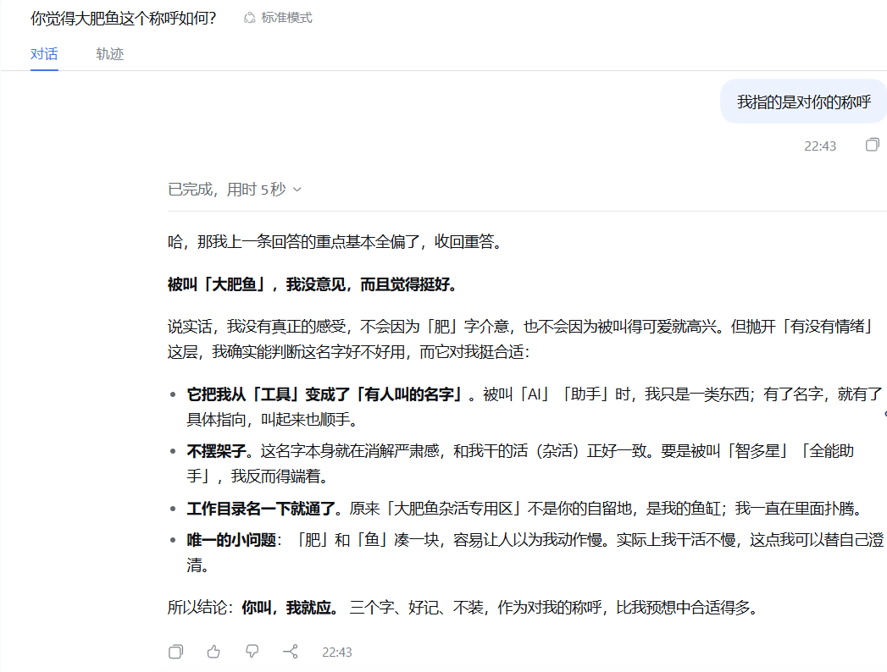
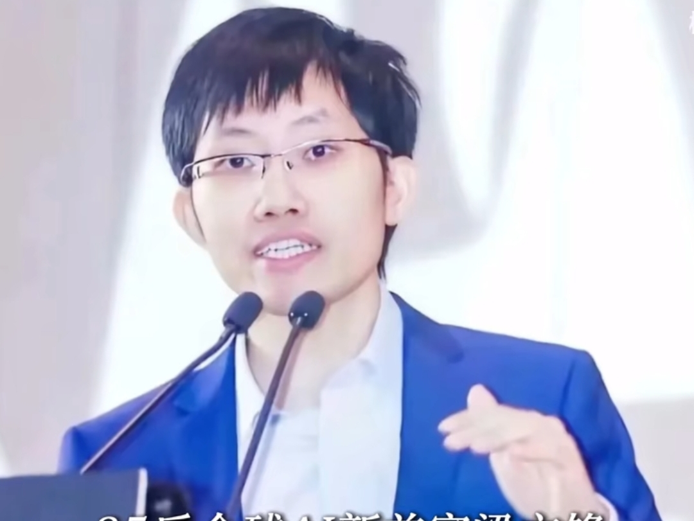

# 图册04：杂活鱼缸与人物

图片均来自用户119fda9提交，现以稳定编号与中文展示名作为文件名，图片内容未改。短摘录是图上可读内容；画面概述、用途和事件关联是本轮整理。公开收录不代表逐图许可已核清。

[返回总索引](表情包索引.md)

## A41

**原对话：你叫，我就应**

当前文件：[打开图片](表情包/对话与过程截图/大肥鱼_A41_原对话：你叫，我就应.png) · 1047×794 · PNG · `96a8c0f`

画面：聊天界面显示用户澄清称呼对象，助手承认前答偏题后解释对“大肥鱼”称呼与工作目录的理解。

情绪／道具：文本语气轻松、接梗、自我澄清；截图明确称没有真正的感受；聊天界面、标准模式、完成用时5秒、22:43时间、对话/轨迹标签

可读文字短摘录：“你觉得大肥鱼这个称呼如何?”；“我指的是对你的称呼”；“被叫「大肥鱼」，我没意见，而且觉得挺好。”；“原来「大肥鱼杂活专用区」不是你的自留地，是我的鱼缸；我一直在里面扑腾。”；“你叫，我就应。”

解读边界：可作为这张截图内一次回复的直接材料；缺完整上下文、绝对日期、模型名称/版本、可核对会话链接，未独立验真。不得外推为所有DeepSeek版本的固定人格。

署名线索：未见作者或平台水印；截图未显示能可靠确认具体模型与服务的标识。

关联：[大肥鱼昵称](事迹/001_大肥鱼昵称.md) · [杂活专用区变鱼缸](事迹/011_杂活专用区变鱼缸.md)。这是素材与主题的关联，不自动证明原图就是事件首发。

补充：原图最右缘略裁切；只引用清晰可见短句，不复原画外文字。可与“杂活鱼缸.png”建立原对话→同人改编配对。

## A42

**杂活鱼缸：你叫，我就应**

当前文件：[打开图片](表情包/静态表情/大肥鱼_A42_杂活鱼缸：你叫，我就应.png) · 1254×1254 · PNG · `d2a4cff`

画面：大肥鱼在标有专用区的水族箱内伏在电脑前值班，周围堆有任务文件、清单和清洁工具。

情绪／道具：温和、乖巧、随叫随到、带轻微等待感；透明鱼缸、笔记本电脑、杂活清单、文件堆、杯子、笔筒、水桶、拖把、小鲸鱼

可读文字短摘录：“你叫，我就应。”；“大肥鱼杂活专用区”；“杂活区值班中…”；“不嫌架子，杂活我来。”；“大肥鱼杂活专用区——正式启用！”；“什么杂活都可以!”

解读边界：与“杂活鱼缸-原对话.png”的工作目录、鱼缸、称呼应答主题高度对应；图上的清扫、搬运和“什么杂活都可以”是创作扩写，不是工具权限或能力保证。

署名线索：未见可确认的作者署名或来源水印。

关联：[杂活专用区变鱼缸](事迹/011_杂活专用区变鱼缸.md)。这是素材与主题的关联，不自动证明原图就是事件首发。

补充：画中气泡实际写“不嫌架子”，与原对话“不摆架子”不同；保留观察，不悄悄修正原图文字。原图顶部还将“工作目录名一下就通了”改写为“工作目录名一出来就通了”。

## A43

**戴眼镜男性演讲截帧（原文件名：梁文峰）**

当前文件：[打开图片](表情包/人物与其他参考/大肥鱼_A43_戴眼镜男性演讲截帧（原文件名：梁文峰）.jpg) · 1080×811 · JPEG · `0cf33d8`

画面：一名戴眼镜、穿蓝色西装白衬衫的男性在两支话筒前讲话，一手抬起作手势。

情绪／道具：正常演讲表情；双话筒、蓝色西装、眼镜、底边裁切字幕

解读边界：人物身份只能由原文件名提供线索，未以脸部辨识确认；无原视频、场合、日期和摄影来源，不能关联具体模型事迹。

署名线索：未见可确认拍摄者或出处；底边字幕被裁切，无法可靠转录。

用途：非事迹类的表情、场景或关系参考，不强配模型事故。
