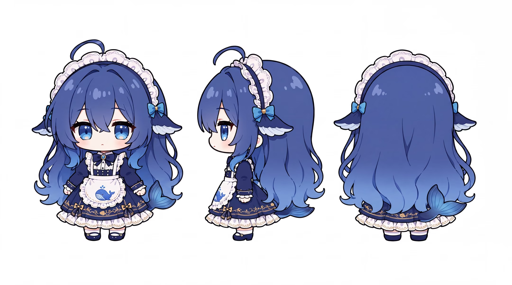
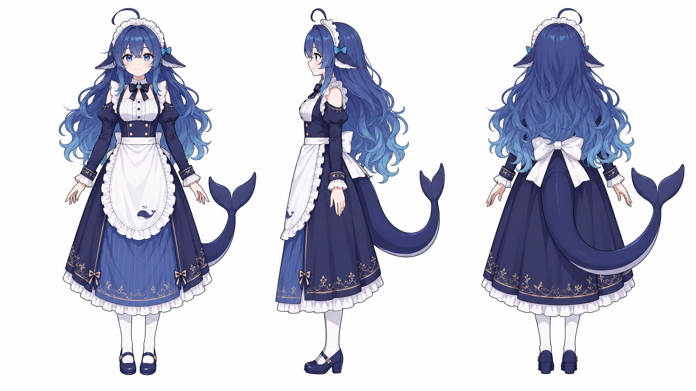

# 视觉形象：先定一个版本，再谈换皮

本轮已实际查看用户上传的三张参考图，并结合上游规范整理出识别点：蓝色渐变长发、蓝眼、呆毛、鲸系侧鳍与鲸尾。具体的脸型、头饰、裙摆、配色细节和头身比例，仍以本次创作选定的一套图片为准。

- [已看三视图的逐项观察](../01_设定与关系.md#3-当前三视图的可见内容)
- [原型、女仆版、大小比例与后续作者的关系](../来源考据/创作者链与许可.md)
- [图片接收与分类状态](../模型事迹及其表情包/表情包索引.md)

## 六件事分别选

| 要选的内容 | 例子 |
|---|---|
| 身份 | 这是谁，哪些特征让人认得出来 |
| 画风 | 线稿、赛璐璐、水彩、三维等 |
| 服装 | 女仆装、雨衣、日常服，按作品决定 |
| 比例 | Q版、较修长等；比例变化不等于年龄变化 |
| 动作 | 抱盆、端饭、打字、叉腰，注意手和道具接触 |
| 场景 | 桌前、厨房、水边、透明背景等 |

例如，用女仆三视图当身份参考、另选雨衣造型时，不必把白围裙和所有裙边塞进雨衣；但也不能把头发、脸与鲸尾一起换成另一个角色。一个作品里的各张图尽量保持同一设计，换皮另记版本。

本轮仅查看与索引用户原图，没有生成新的立绘、三视图、表情或三维模型。缺的视角若以后创作补齐，应标“补设”，不能称找回原作者设计。

## 已入库参考图

以下三张均来自用户119fda9提交，原文件名不变。编号沿用全库资产清单；“原皮”是用户归档名，具体作者与原帖映射仍需补核。

### A44｜Q版女仆三视图

圆脸、大头短肢、短裙。深蓝头顶渐变浅蓝发梢、蓝眼、弯呆毛、蓝白鳍状侧饰、蓝蝴蝶结与鲸尾；白围裙有鲸鱼图案，裙边与袖口有少量金色装饰。侧视可看到人耳。适合表情、短漫和强调小动作的画面。

### A45｜较修长女仆三视图

正侧背三面展示长裙、露肩与分离感袖口、腰后大白蝴蝶结、较高跟鞋和大鲸尾。头发、眼睛与鲸系识别元素延续，但不是把Q版简单拉长：裙长、肩袖结构、鞋型及部分装饰本来就有区别。做同一套连续画面时，别混用两套服装结构。

### A46｜较修长女仆原形象立绘

单幅全身，微笑、摊手、另一手提裙，长发与尾巴形成舒展轮廓。适合看整体气质、动态和正面服装细节；侧面与背面优先查A45，不从此图猜看不见的细节。

## 哪些固定，哪些不必固定

- 固定的是一组能认人的特征：发色层次、头发轮廓、脸与眼睛、呆毛、鲸系侧饰和尾巴。
- Q版和较修长版分别保持内部一致，不从比例推断人物年龄。
- 女仆装是这组默认服装；铁盆、饭碗、枪械、锅铲等属于具体梗的道具，不常驻身体。
- 实景合成、布偶感、动画、插画可以是不同表现方式。不要从某一张二创的夸张表情倒推新的永久生理设定。
- 精确色值、头身比与三维几何本轮未测量，不伪造数字约束。
